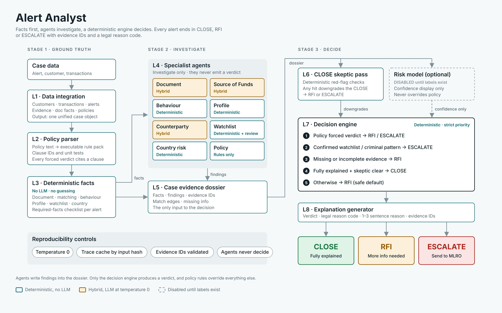

# Finance Crime Hackathon

A hackathon project to build a system that reviews transaction monitoring alerts and decides on each case: **CLOSE**, **RFI** (request for information) or **ESCALATE** to the MLRO. The goal is to close as many cases as the evidence safely allows.

The full brief is in [`hackathon/BRIEF.html`](hackathon/BRIEF.html), and the build guide is in [`hackathon/README.md`](hackathon/README.md).

## Architecture

Alert Analyst pipeline: deterministic ground truth and decisioning, with optional LLM assist (temperature 0) for investigation only. Agents never emit the final verdict.



Details of the implemented runtime (including the surrounding LLM) are in [`hackathon/system/ARCHITECTURE.md`](hackathon/system/ARCHITECTURE.md).

**LLM in this system:** yes, but only around the edges:
- `analyze.py` — optional labels for chats/notes the phrase list missed
- `surrounding.py` — optional second pass on weak residues (findings / missing info only)
- Final **CLOSE / RFI / ESCALATE** always comes from `decide.py` (deterministic). No API key → fully rule-based.

## Layout

```
hackathon/
├── BRIEF.html           # Full brief: transaction monitoring, institutions, scoring
├── README.md            # Build guide: goal, file formats, deliverables, rules
├── institutions/        # Development data, 1000 cases per institution
│   ├── bank/
│   ├── emoney/
│   ├── investment/
│   └── payments_fx/
├── system/              # The alert-closing system
└── output/              # System answers on the development cases
docs/
└── alert-analyst-architecture.jpg
```

Each institution folder has its own `POLICY.md`, and the four policies differ. Each folder also has these data files: `cases.jsonl`, `alerts.jsonl`, `customers.jsonl`, `transactions.jsonl`, `evidence.jsonl` with `evidence/`, `previous_reviews.jsonl` and `internal_list.jsonl`.

## Running

```
system/run <institution folder> <output file>
# e.g.
system/run institutions/bank output/bank.jsonl
```

The system writes one JSON line per case, with these fields: `case_id`, `alert_ids`, `verdict`, `reason_code`, `reason` and `evidence`.

## Constraints

- Only the standard library of Python 3 or Node.js, or shell. No installed packages.
- Optional LLM calls through xAI (`XAI_API_KEY`) or OpenRouter (`OPENROUTER_API_KEY`).
- A run of 200 cases must take under 30 minutes and cost under about US$4.
- The output must be deterministic, because scoring runs the system five times.
- Wrongly closing a case that needed an RFI or an escalation costs 10. Not closing a closable case costs 3.

## License

See [LICENSE](LICENSE).
